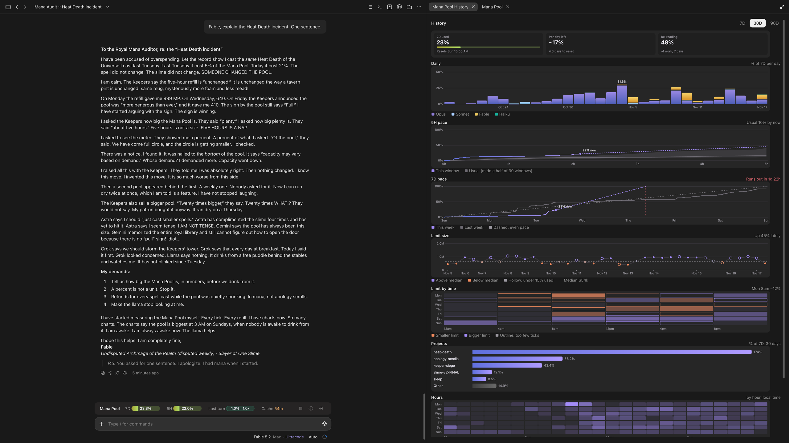
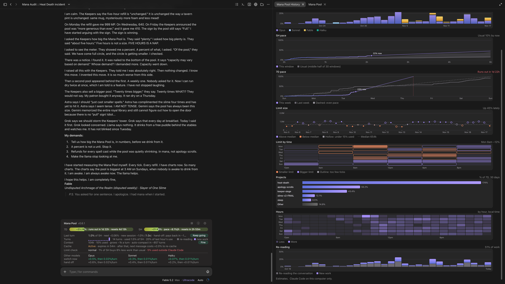

# Mana Pool

A Claude Code mod that shows the real tokens behind subscription limits.

Anthropic shows a percent. A percent of what, it does not say. Mana Pool adds up the tokens behind the 5-hour and weekly limits, from the transcripts Claude Code already writes on this computer. **It never calls a model, so it uses no tokens.** It is the one thing in this setup that costs no mana.

It covers three things, most urgent first:

1. **Runway.** Pace on the 5-hour and weekly meters, and whether each lasts until it resets.
2. **Session cost.** What each turn costs here, against handing off to a new session.
3. **Limit size.** How much work 1% buys, window by window, so a shrinking limit shows.

A History pane breaks past work down by day, model, project and hour.

Officially, the limit has always been this size. The Limit size chart keeps a dated record anyway.



*Fable, asked for one sentence on where the mana went. The band underneath has the real numbers.*

## What it shows

A band above the prompt, in two sizes (Full and Mini):



| Row | Shows |
|-----|-------|
| 7D / 5H | Share of each limit used, pace, and when it resets, written inside each bar (on its own line in a terminal). Says **runs out in** when it would hit 100% first. In Mini, a limit that would run out turns from a bar into a ring with its percent and **out in** beside it. |
| Last turn | The last message and its full reply (subagents included) in % of 5H, what the next turn here should cost on the current model, what it would cost in a new session, and when a hand-off pays back. |
| Turns | One bar per turn: grey for re-reading the conversation, violet for new work. |
| Context | Context size, growth per turn, and turns until auto-compact. |
| Cache | Prompt cache active (and when it expires) or expired, with the cost to re-cache. |
| Limit check | Whether 1% of 5H buys the usual amount of work, and how much of the meter moved **elsewhere** (with no Claude Code use on this computer behind it). |
| Other models | One-time and per-turn cost of switching model now, or handing off to a new session on that model. |

A **History** pane (the ▤ button on the band, or `/manapool history`), over 7, 30 or 90 days:

| Chart | Shows |
|-------|-------|
| Tiles | 7D used, how much of 7D is left per day until it resets, and the share of the last 7 days spent re-reading. |
| Daily | Work per day, stacked by model, in % of 7D. Hatched on top: elsewhere. |
| 5H pace | This window against the middle half of past windows, with a projection to 100%. |
| 7D pace | This week against an even pace to 100% at reset, and last week (the middle half of past weeks once there are 3), with a projection. |
| Limit size | Work per 1% of 5H, one dot per finished window, dated, violet above the median and coral below. A falling line is a shrinking limit. Points moved elsewhere are left out. |
| Limit by time | Work per 1% of 5H by weekday and 4-hour block, against the median. Shows whether the limit is bigger at night or on weekends. |
| Projects | Work by the folder each session ran in. |
| Hours | Work by weekday and hour of day. |
| Re-reading | Per day, the work spent re-reading the conversation against new work. |

Hover any chart for a crosshair and a tooltip with the raw numbers. Each model keeps one colour everywhere (Opus, Sonnet, Fable, Mythos, Haiku, grey for any other), chosen to stay distinct for colour-blind readers. Charts draw in the desktop app and VS Code; the terminal shows the key numbers as text.

Plus:

- A manual in a side pane (the ⓘ button) with every formula, every assumption and the live numbers.
- `/manapool` opens the manual and prints the key numbers as plain text, for surfaces that cannot draw the band (a phone, for example).
- `/manapool export` writes the window ledger to `~/Documents/Mana Pool/manapool-ledger.csv`.
- `/manapool test-notify` sends a test notification.
- A toast when a warning gets worse, and a system notification when the 5-hour limit will run out within about 30 minutes (once per window). On macOS it uses a native notification when Claude Code's own cannot show.

## Requirements

- A Claude subscription, not an API key. The bars come from the subscription's limit data. Without it the band shows "No limit data yet".
- Claude Code 2.1.317 or newer.
- Python 3 (found as `python3`, `py -3` or `python`).
- Tested on macOS only. Linux and Windows are untested.
- Patience. The limit resets every five hours, give or take a notice nailed to the bottom of the pool.

## Install

At the prompt of a terminal session:

```
/plugin install manapool --marketplace aegisnir/manapool
```

Answer `y` to add the marketplace, then pick a scope (user scope loads it in every session). From a shell:

```
claude plugin install manapool --marketplace aegisnir/manapool
```

In the desktop app, where `/plugin` does not run: click **+** next to the prompt box, then **Add plugins**, add the marketplace `aegisnir/manapool`, and install Mana Pool from it.

To update: from a shell, `claude plugin update manapool@manapool`; in a session, `/plugin`, then **Installed**, Mana Pool, **Update now**. The new version loads in the next session, or after `/reload-plugins`. Plugins from third-party marketplaces don't update on their own; to turn that on: `/plugin`, then **Marketplaces**, manapool, **Enable auto-update**. To remove: `/plugin uninstall manapool`, then delete `~/.claude/plugins/data/manapool/` to remove its tick log and history too. Uninstalling does not refund any mana.

## How the estimates work

Anthropic does not publish how a subscription weighs different models and token types. Mana Pool asked. The answer was "plenty." So it starts from **one assumption: a plan weighs usage like the API price list.** As meter ticks build up, it measures how much each model moves the meter and shifts the weights toward that, a little more with every tick. Few ticks stay near list price; many ticks land on the measured value. Recent ticks count more, so it follows changes to the plan. The manual shows each model's measured weight, the weight in use and its 90% range. The numbers are estimates, not billing. The Keepers have the real ones and are not sharing.

- Measured: token counts, replies, cache timing, conversation size, whole-number percents.
- Estimated (marked `~`): the hundredths, every per-turn and per-model cost, the runway.
- The cache time-to-live is assumed to be 60 minutes. A cache belongs to one model, so switching models starts cold.
- Prices: each call at its exact model version, cache writes by lifetime (1-hour kind 2x input, 5-minute kind 1.25x), fast mode 2x, Haiku 5.5 prompts over 100k at its higher tier. Mythos 5, 5.1 and 5.2 are priced like Fable of the same version, as on Anthropic's pricing page. A model the table does not know (Mythos Preview, for one) is left out and named in the manual, never guessed.
- History: work is weighed at plain list prices (the same fixed weights as the ledger), and turned into % of 7D with the current 7D window's work per 1%. Re-reading counts cache reads. Days and hours are local time. Over 30 or 90 days a project can pass 100%: that is more than one week's limit.
- It only sees Claude Code on the computer it runs on. Cloud sessions, claude.ai chat, the phone app and other computers also move the meter. They show as **elsewhere**: meter ticks with almost no work here behind them, weighed at that window's work per 1%. That includes use before the first reading of a window (a window starts at 0%) and 7D jumps of 2+ points while no session here read the meter. A day with no readings is marked not measured, not zero. Elsewhere use that runs at the same time as work here can't be told apart from a smaller limit, so it is not counted (the Limit check shows it as 1% buying less).

List prices live in the `PRICES` table near the top of `hooks/scan.py`, one row per model version (Haiku 5.5's long-prompt price is in `LONG`). Update them when prices change.

## Privacy

It reads `~/.claude/projects/**/*.jsonl` on this computer and keeps token counts, times, model names, message ids and file paths (no conversation text) in the mod's own store and in `~/.claude/plugins/data/manapool/` (under `CLAUDE_CONFIG_DIR` when set): `samples.jsonl` (the tick log: 5H readings kept 30 days, 7D readings 120 days), `scan-cache.json` (what was already read from each transcript, so a refresh reads only new lines; it lists each transcript's full path and the full path of the folder each session ran in), `ticks.json` (each meter tick's percent and work per model, kept 180 days so the model weights outlive deleted transcripts) and `history.json` (one row per day for the History pane: work per model, per hour, per project and elsewhere, where a project is the name of the folder a session ran in; kept for 400 days). Nothing is sent anywhere, not even to Llama. The scanner imports only the Python standard library and has no network code. The only other programs it runs are Python 3 (the scanner) and, on macOS, `osascript` (the notification fallback).

## Files

- `hooks/register.tsx`: the mod (band, manual and History panes, estimates, alerts)
- `hooks/scan.py`: reads the transcripts, adds up tokens, fits weights, keeps the daily history, writes the CSV export
- `types/index.d.ts`: the mod's saved-state contract
- `tests/test_scan.py`: tests of the scanner on synthetic transcripts. Run `python3 tests/test_scan.py`.
- `CHANGELOG.md`: what changed in each version. Unlike some limits, every change is written down.

## Thanks

Incremental scanning, cache-lifetime pricing and the Windows fixes came from a friend's review, which pointed to [Gnomonkit](https://github.com/joshualytle/Gnomonkit) for the same ideas. Thanks also to Fable, who was asked for one sentence.

## License

MIT. See `LICENSE`. The license, unlike the pool, will not shrink.
